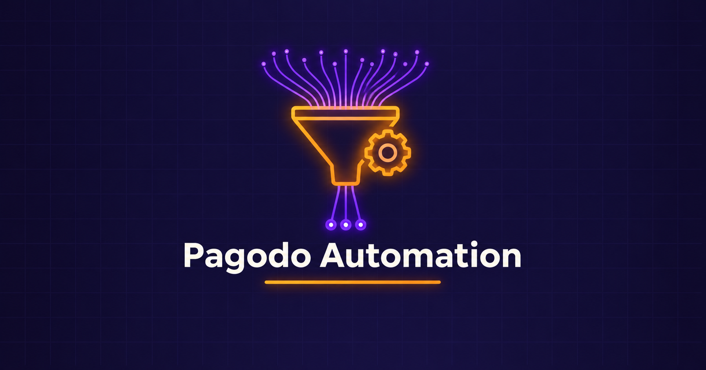

  

<h1 align="center">Automated Passive Recon — Pagodo & GHDB Dork Automation</h1>
<h3 align="center">Scaling Google Dorking with Priority-Based Python Automation</h3>

  
  

  <a href="#overview">Overview</a> ·
  <a href="#key-findings">Key Findings</a> ·
  <a href="#evidence">Evidence</a> ·
  <a href="#tools">Tools</a> ·
  <a href="Lab-Report.pdf">Full Report</a> ·
  <a href="../README.md">Back</a>

---

## Overview

| Item | Detail |
|---|---|
| Objective | Automate GHDB dork scraping, filtering and prioritized scanning using Pagodo and custom Python scripts |
| Target | Test-lab-scoped target domain (used as a filtering/automation demo, test environment) |
| Pipeline | GHDB scrape → filter → priority-rank → auto-scope → scan |

## Key Findings

| Step | Result |
|---|---|
| GHDB Dorks Scraped | 7,944 total |
| Custom Filter Script | Reduced to 4,181 relevant dorks (52.6% reduction) |
| Smart Priority Script | Ranked into High/Medium/Low tiers; top 100 auto-selected and auto-scoped with `site:` |
| Rate-Limit Handling | Pagodo correctly detected Google IP block and auto-slept 60 minutes before resuming |
| Output | JSON + TXT result files and full scan log generated |

## Evidence

ghdb_scraper.py pulling the full GHDB dork library.

filter_dorks.py output: 7,944 → 4,181 relevant dorks.

smart_dork.py priority-tier ranking and top-100 selection.

Pagodo log showing Google IP-block detection and automatic 60-minute sleep/resume.

## Tools

| Tool | Role |
|---|---|
| Pagodo | Automated GHDB dork scanning against a target |
| Python (custom scripts) | Dork filtering and priority-based ranking |
| Git | Cloning Pagodo from GitHub |

---

  <a href="Lab-Report.pdf">📄 Full Report</a> ·
  <a href="../README.md">⬅ Back to OSINT Section</a> ·
  <a href="../../README.md">⬅ Back to Main Repo</a>

