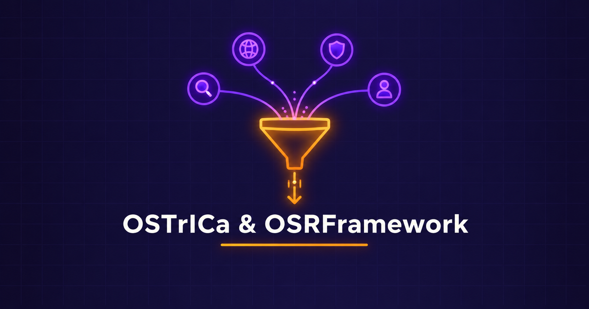

  

<h1 align="center">OSINT Collection — OSTrICa & OSRFramework</h1>
<h3 align="center">Multi-Source Threat Intelligence Aggregation & Username Enumeration</h3>

  
  

  <a href="#overview">Overview</a> ·
  <a href="#key-findings">Key Findings</a> ·
  <a href="#evidence">Evidence</a> ·
  <a href="#tools">Tools</a> ·
  <a href="Lab-Report.pdf">Full Report</a> ·
  <a href="../README.md">Back</a>

---

## Overview

| Item | Detail |
|---|---|
| Objective | Use OSTrICa to aggregate domain threat intel and OSRFramework to enumerate usernames across platforms |
| Target | `www.certifiedhacker.com` (OSTrICa) and username `analyst` / page `certifiedhacker` (OSRFramework) |
| Platform | Kali Linux, Python 2 (OSTrICa) / Python 3 (OSRFramework) |

## Key Findings

| Tool | Result |
|---|---|
| OSTrICa | Loaded plugins: SafeBrowsing, ThreatCrowd, PyWhois, DomainBigData, BlackLists, ThreatMiner, NortonSafeWeb; some failed (missing deps / SSL error) |
| OSTrICa Graph | Generated an intelligence graph (limited to a single consolidated node due to partial plugin failures) |
| OSRFramework usufy.py | Located username `analyst` on GitHub and Instagram across VK/GitHub/Instagram search |
| OSRFramework searchfy.py | Searched for page `certifiedhacker` across GitHub, Instagram, KeyServerUbuntu — no public subscriber data found |

## Evidence

OSTrICa v0.5 loaded with available plugin list.

Intelligence extraction run against www.certifiedhacker.com.

Generated intelligence graph opened in browser.

OSRFramework — usufy.py profile search result across VK, GitHub, Instagram.

## Tools

| Tool | Role |
|---|---|
| OSTrICa | Multi-plugin domain/IP/email/hash threat intelligence collection |
| OSRFramework (usufy.py, searchfy.py) | Username and page-subscriber enumeration across platforms |

---

  <a href="Lab-Report.pdf">📄 Full Report</a> ·
  <a href="../README.md">⬅ Back to OSINT Section</a> ·
  <a href="../../README.md">⬅ Back to Main Repo</a>

