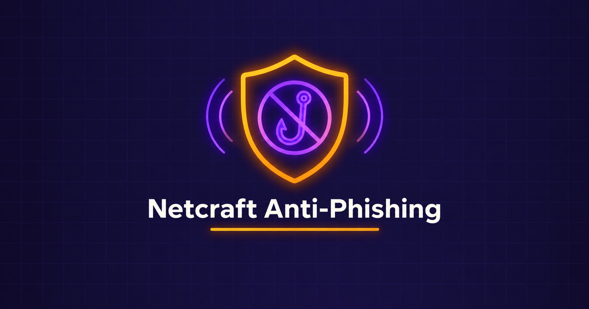

  

<h1 align="center">Anti-Phishing Defense — Netcraft Browser Extension</h1>
<h3 align="center">Real-Time Phishing Detection, Site Intelligence & Fraud Reporting</h3>

  
  

  <a href="#overview">Overview</a> ·
  <a href="#key-findings">Key Findings</a> ·
  <a href="#evidence">Evidence</a> ·
  <a href="#tools">Tools</a> ·
  <a href="Lab-Report.pdf">Full Report</a> ·
  <a href="../README.md">Back</a>

---

## Overview

| Item | Detail |
|---|---|
| Objective | Install and use the Netcraft browser extension as a defensive countermeasure against the Gophish/SET techniques |
| Platform | Firefox Add-Ons Store |
| Target tested | certifiedhacker.com (inline panel), netcraft.com (full site report reference) |

## Key Findings

| Finding | Detail |
|---|---|
| Site Report Panel | Shows country, site rank, first-seen date and host at a glance |
| Full Site Report | Background, network, IP delegation and geolocation data |
| IP Delegation | Traced IANA → regional registry → final network block owner |
| Geolocation | Multilateration-based server location, more reliable than simple IP lookup |
| Fraud Reporting | Built-in one-click submission of suspicious URLs to Netcraft's takedown team |
| Defensive mapping | Directly counters Gophish/SET techniques via First-Seen date and IP attribution |

## Evidence

Netcraft Extension installed and active in Firefox.

Inline Site Report panel showing rank, host, country and first-seen date.

Full Site Report: IP delegation chain (IANA → RIR → network owner).

Netcraft Trends: historical site ranking data.

## Tools

| Tool | Role |
|---|---|
| Netcraft Browser Extension | Real-time phishing/site reputation detection |
| Netcraft Full Site Report | Network, IP delegation & geolocation intelligence |
| Netcraft Trends | Historical ranking & hosting-change tracking |

---

  <a href="Lab-Report.pdf">📄 Full Report</a> ·
  <a href="../README.md">⬅ Back to Phishing Section</a> ·
  <a href="../../README.md">⬅ Back to Main Repo</a>

