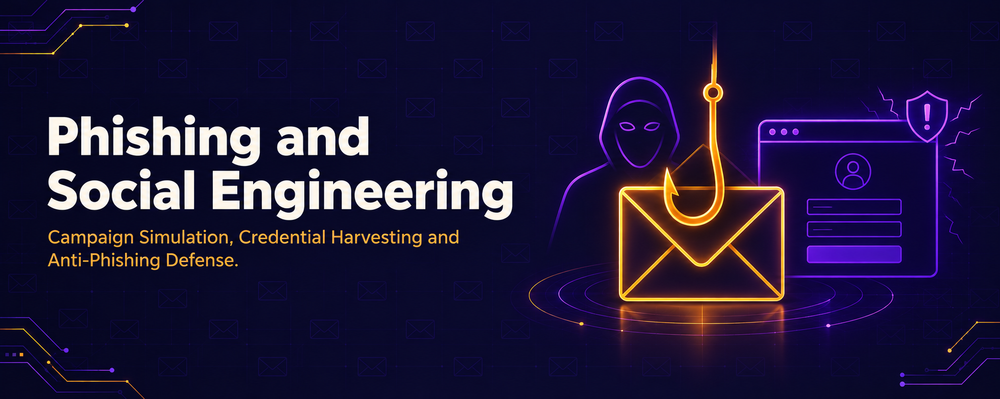

  

<h1 align="center">Phishing and Social Engineering</h1>
<h3 align="center">Campaign Simulation, Credential Harvesting and Anti-Phishing Defense</h3>

  
  

  <a href="#overview">Overview</a> ·
  <a href="#labs">Labs</a> ·
  <a href="#campaign-lifecycle">Campaign Lifecycle</a> ·
  <a href="../README.md">Back to Main Repo</a>

---

## Overview

This section documents the human-layer attack phase: building and launching a phishing campaign end-to-end with Gophish, generating payloads and harvesting credentials with the Social-Engineer Toolkit (SET), and closing the loop with Netcraft as the defensive countermeasure that detects and reports these same techniques. All activity was performed in a closed, authorized lab against the author's own test accounts and infrastructure.

## Labs

| # | Module | Tool(s) | Key Output |
|---|---|---|---|
| 08 | [Gophish Campaign](M08-Gophish-Campaign) | Gophish | Full sending-profile → template → landing-page → campaign flow |
| 09 | [Social Engineering Toolkit](M09-Social-Engineering-Toolkit) | SET, Metasploit, Netcat | Payload generation, mass mailer, credential harvester, link spoofing |
| 10 | [Netcraft Anti-Phishing](M10-Netcraft-Anti-Phishing) | Netcraft Browser Extension | Site reputation, IP attribution, fraud reporting |

## Campaign Lifecycle

| Stage | Module | Description |
|---|---|---|
| 1. Infrastructure Setup | Gophish | Sending profile (SMTP) and landing page configured |
| 2. Payload/Lure Creation | Gophish / SET | Branded email template imported; reverse-shell payload generated |
| 3. Delivery | Gophish / SET Mass Mailer | Campaign launched to target group / email list |
| 4. Capture | Gophish / SET Credential Harvester | Form submissions and credentials logged |
| 5. Tracking | Gophish Dashboard | Per-recipient delivery/click/submit status monitored |
| 6. Detection (Defense) | Netcraft | Same lure/clone patterns identified and flagged as phishing |

---

<a href="../README.md">⬅ Back to Main Repository</a>

