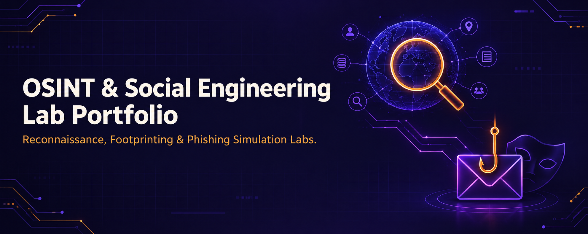

<div align="center">



<br><br>

<h1>OSINT & Social Engineering Lab Portfolio</h1>
<h3>Reconnaissance, Footprinting & Phishing Simulation Labs — From Passive Recon to Human-Layer Exploitation</h3>

<br>


<br><br>

<a href="#overview"><b>Overview</b></a> &nbsp;·&nbsp;
<a href="#osint-and-footprinting"><b>OSINT & Footprinting</b></a> &nbsp;·&nbsp;
<a href="#phishing-and-social-engineering"><b>Phishing & Social Engineering</b></a> &nbsp;·&nbsp;
<a href="#tools--technologies"><b>Tools</b></a> &nbsp;·&nbsp;
<a href="#repository-structure"><b>Structure</b></a> &nbsp;·&nbsp;
<a href="#license--usage-rights"><b>License</b></a> &nbsp;·&nbsp;
<a href="#contact"><b>Contact</b></a>

</div>

<br>

---

## Overview

This repository documents hands-on OSINT and social engineering labs covering the reconnaissance and human-layer phases of the penetration testing lifecycle — starting with passive OSINT collection (WHOIS, DNS, Google Dorking, Maltego) and ending with phishing simulation and anti-phishing defense (Gophish, SET, Netcraft).

Every lab was executed against the public pentest-practice target `certifiedhacker.com` or the author's own test accounts and infrastructure — fully documented with step-by-step evidence.

Each module lives in its own directory — complete with a dedicated README, the full PDF report, and supporting screenshots.

> All labs were executed in a closed, authorized lab environment using the public pentest-practice target `certifiedhacker.com`, self-owned test accounts, and isolated virtual machines. No real individuals, organizations, or production systems were targeted without consent.

<br>

## OSINT and Footprinting

<table>
<tr><th>#</th><th>Module</th><th>Focus</th><th>Core Tools</th></tr>

<tr><td>01</td><td><a href="./01-OSINT-and-Footprinting/M01-WHOIS-and-NSLookup/">WHOIS & NSLookup</a></td><td>Domain ownership & DNS record footprinting</td><td><code>whois</code> <code>nslookup</code></td></tr>

<tr><td>02</td><td><a href="./01-OSINT-and-Footprinting/M02-Email-Header-Tracing/">Email Header Tracing</a></td><td>Email origin, IP & route tracing</td><td><code>eMailTrackerPro</code></td></tr>

<tr><td>03</td><td><a href="./01-OSINT-and-Footprinting/M03-Google-Dorking-and-GHDB/">Google Dorking & GHDB</a></td><td>Search operators & Google Hacking Database recon</td><td><code>Google Search Operators</code> <code>Exploit-DB GHDB</code></td></tr>

<tr><td>04</td><td><a href="./01-OSINT-and-Footprinting/M04-Pagodo-Automation/">Pagodo Automation</a></td><td>Automated GHDB dork filtering & scanning pipeline</td><td><code>Pagodo</code> <code>Python</code></td></tr>

<tr><td>05</td><td><a href="./01-OSINT-and-Footprinting/M05-Maltego/">Maltego</a></td><td>Graph-based infrastructure & entity recon</td><td><code>Maltego CE</code></td></tr>

<tr><td>06</td><td><a href="./01-OSINT-and-Footprinting/M06-OSTrICa-and-OSRFramework/">OSTrICa & OSRFramework</a></td><td>Multi-source threat intel aggregation & username recon</td><td><code>OSTrICa</code> <code>OSRFramework</code></td></tr>

<tr><td>07</td><td><a href="./01-OSINT-and-Footprinting/M07-Website-Mirroring-HTTrack/">Website Mirroring (HTTrack)</a></td><td>Offline site mirroring & metadata extraction</td><td><code>HTTrack</code> <code>Web Data Extractor</code></td></tr>

</table>

<br>

## Phishing and Social Engineering

<table>
<tr><th>#</th><th>Module</th><th>Focus</th><th>Core Tools</th></tr>

<tr><td>08</td><td><a href="./02-Phishing-and-Social-Engineering/M08-Gophish-Campaign/">Gophish Campaign</a></td><td>End-to-end phishing campaign simulation</td><td><code>Gophish</code></td></tr>

<tr><td>09</td><td><a href="./02-Phishing-and-Social-Engineering/M09-Social-Engineering-Toolkit/">Social Engineering Toolkit</a></td><td>Mass mailer, payload delivery & credential harvesting</td><td><code>SET</code> <code>Metasploit</code> <code>Netcat</code></td></tr>

<tr><td>10</td><td><a href="./02-Phishing-and-Social-Engineering/M10-Netcraft-Anti-Phishing/">Netcraft Anti-Phishing</a></td><td>Defensive countermeasure & phishing detection</td><td><code>Netcraft Browser Extension</code></td></tr>

</table>

<br>

## Key Results

<table>
<tr><th>Lab</th><th>Result</th></tr>
<tr><td>WHOIS & NSLookup</td><td>Mapped domain ownership, nameservers & DNS record types</td></tr>
<tr><td>Email Header Tracing</td><td>Traced sender IP, geolocation & mail routing path from a real header</td></tr>
<tr><td>Google Dorking & GHDB</td><td>Demonstrated 15+ search operators across 7 GHDB vulnerability categories</td></tr>
<tr><td>Pagodo Automation</td><td>Reduced 7,944 GHDB dorks to 100 high-priority, target-scoped queries (~98.7% reduction)</td></tr>
<tr><td>Maltego</td><td>Resolved 7 subdomains, hosting provider, IP geolocation & WHOIS entities in 12 transforms</td></tr>
<tr><td>OSTrICa & OSRFramework</td><td>Ran multi-plugin domain intel extraction and cross-platform username lookup</td></tr>
<tr><td>Website Mirroring</td><td>Mirrored full site structure and extracted meta tags, emails & phone numbers</td></tr>
<tr><td>Gophish Campaign</td><td>Built and launched a full 5-component phishing campaign with tracking</td></tr>
<tr><td>SET</td><td>Generated a reverse-shell payload, harvested cleartext credentials, and spoofed a trusted link</td></tr>
<tr><td>Netcraft</td><td>Verified real-time phishing detection, site reputation & IP attribution as a defensive layer</td></tr>
</table>

<br>

## Tools & Technologies

<table>
<tr><td><b>Domain & DNS Recon</b></td><td><code>whois</code> <code>nslookup</code></td></tr>
<tr><td><b>Email Forensics</b></td><td><code>eMailTrackerPro</code></td></tr>
<tr><td><b>Search Engine Recon</b></td><td><code>Google Search Operators</code> <code>Exploit-DB GHDB</code> <code>Pagodo</code></td></tr>
<tr><td><b>Graph & Multi-Source OSINT</b></td><td><code>Maltego CE</code> <code>OSTrICa</code> <code>OSRFramework</code></td></tr>
<tr><td><b>Website Footprinting</b></td><td><code>HTTrack</code> <code>Web Data Extractor</code></td></tr>
<tr><td><b>Phishing & Social Engineering</b></td><td><code>Gophish</code> <code>Social-Engineer Toolkit (SET)</code> <code>Metasploit</code> <code>Netcat</code></td></tr>
<tr><td><b>Anti-Phishing Defense</b></td><td><code>Netcraft Browser Extension</code></td></tr>
</table>

<br>

## Lab Environment

| | |
|---|---|
| **OS** | Kali Linux · Windows 10 |
| **Networking** | Isolated/local lab network (127.0.0.1, local VMs) |
| **Target** | `certifiedhacker.com` (public pentest practice site) and self-owned test accounts |
| **Scope** | All labs performed in a closed, authorized lab environment for educational purposes |

<br>

## Repository Structure

Each module is fully self-contained — its own README with a cover image and summary, the full PDF report, and a screenshot folder.

```
osint-social-engineering-lab-portfolio/
├── README.md
├── LICENSE
├── images/
│   └── banner.png
│
├── 01-OSINT-and-Footprinting/
│   ├── README.md
│   ├── images/
│   │   └── bannerosint.png
│   ├── M01-WHOIS-and-NSLookup/
│   │   ├── README.md
│   │   ├── Lab-Report.pdf
│   │   └── images/
│   ├── M02-Email-Header-Tracing/
│   ├── M03-Google-Dorking-and-GHDB/
│   ├── M04-Pagodo-Automation/
│   ├── M05-Maltego/
│   ├── M06-OSTrICa-and-OSRFramework/
│   └── M07-Website-Mirroring-HTTrack/
│
└── 02-Phishing-and-Social-Engineering/
    ├── README.md
    ├── images/
    │   └── bannersoc.png
    ├── M08-Gophish-Campaign/
    ├── M09-Social-Engineering-Toolkit/
    └── M10-Netcraft-Anti-Phishing/
```

<br>

## License & Usage Rights

**© 2026 Abdul Wahid. All Rights Reserved.**

Licensed under **[MIT License](./LICENSE)**.

| Permitted | Not Permitted |
|---|---|
| View, read, and reference this work | Redistribute or republish without credit |
| Share a link to this repository | Misrepresent this work as your own |
| Cite it in your own research/portfolio with attribution | Use any content to target real individuals or organizations |

For any use beyond this license, reach out via the contact details below.

<br>

## Disclaimer

All labs in this repository were performed exclusively in a closed, authorized lab environment using the public pentest-practice target `certifiedhacker.com`, self-owned test accounts, and isolated virtual machines. **No real individuals, organizations, or production systems were targeted without consent.** OSINT data (WHOIS/registrant records, email headers) shown in this repository is limited to what is already publicly indexed about the test target; any real third-party personal data, live vulnerable hosts, or exposed credentials surfaced incidentally during labs have been redacted, defanged, or excluded from screenshots and reports. Phishing templates and cloned pages shown here were built and tested only against the author's own accounts/infrastructure and are not intended to impersonate any real brand for malicious use. This repository is for educational and authorized security-training purposes only.

<br>

## Contact

<div align="center">

**Abdul Wahid**
OSINT & Social Engineering — Security Lab Portfolio

<br>

<a href="mailto:a.wahid7860668@gmail.com"></a>
<a href="https://www.linkedin.com/in/abdul-wahid022"></a>
<a href="https://github.com/abdul-wahid022"></a>

<br><br>

<sub>If this portfolio was useful to you, consider starring the repository.</sub>

</div>
